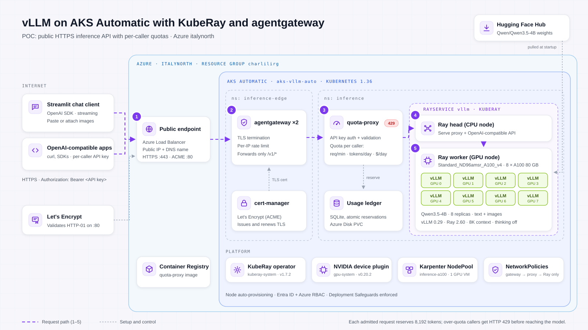

# vLLM on AKS Automatic, KubeRay, and agentgateway

Deploys a **public** OpenAI-compatible HTTPS inference API with per-caller
authentication, request limits, daily token quotas, and daily chargeback budgets.

It serves three models with **smart routing**: callers send `"model": "auto"`,
and the quota proxy picks a model for each request before charging quota.
A message with an image goes to Qwen3.5-4B. For text, a small CPU decision
model, the **smart router**, sends coding and math prompts to gpt-oss-120b and
simple prompts to the cheaper gpt-oss-20b. Callers can also choose a model by
name. See [Model routing](#model-routing).



A 2560×1440 PNG for slides is in [`docs/architecture.png`](docs/architecture.png).

```text
Internet caller -- HTTPS (Let's Encrypt) --> Azure public IP + DNS name
       --> agentgateway (2 replicas: TLS, per-IP rate limit)   [inference-edge]
       --> quota-proxy (API key, "auto" model routing,
                        atomic durable reservation)            [inference]
           <-> model-router (CPU decision model for "auto")    [inference]
       --> KubeRay RayService / Ray Serve LLM / vLLM:
           gpt-oss-20b x3, gpt-oss-120b x3, qwen3.5-4b x2
       --> 1 x Standard_ND96amsr_A100_v4 (8 x A100)
```

## Target and verified prerequisites

- Subscription: the current default from `az account show`; no subscription is
  selected or changed by the scripts.
- Resource group: `charlilirg` (must already exist).
- Region: `italynorth`.
- AKS cluster: `aks-vllm-auto`, SKU **Automatic** with node auto-provisioning.
- GPU: exactly `Standard_ND96amsr_A100_v4`; no SKU or region substitution.
- Models: three public Apache 2.0 models, one vLLM replica per GPU, each with
  context length 8192. The split uses the requested VM deliberately, not as a
  cost-optimized model/hardware recommendation.

  | API model ID | Hugging Face model | Replicas | Role | Chargeback |
  | --- | --- | --- | --- | --- |
  | `gpt-oss-20b` | `openai/gpt-oss-20b` | 3 | Cheap text model | 1× |
  | `gpt-oss-120b` | `openai/gpt-oss-120b` | 3 | Strong text model for coding and math | 3× |
  | `qwen3.5-4b` | `Qwen/Qwen3.5-4B` | 2 | The only vision model | 1× |
  | `auto` | — | — | The quota proxy picks one of the above per request; see [Model routing](#model-routing) | As routed |

- gpt-oss models are text-only reasoning models. Their MXFP4 weights load as
  about 14 GiB and 66 GiB, so each fits one A100 80GB; vLLM runs them with
  Marlin kernels on A100. One gpt-oss-120b replica keeps about 84,000 tokens of
  KV cache, enough for about 10 concurrent full-context requests (30 across its
  3 replicas); two GPUs per replica (`tensor_parallel_size: 2`) would allow
  many more. They reason before answering, and reasoning tokens count toward
  `max_tokens`; vLLM returns the reasoning in a separate `reasoning` field, not
  in the answer. The
  quota proxy sets `reasoning_effort` to `low` for gpt-oss-20b and `medium`
  for gpt-oss-120b; callers cannot change it.
- Qwen3.5 is a vision-language model that thinks before answering by default.
  The engine runs with thinking off (`enable_thinking: false`), so image
  questions get direct answers. It accepts at most 2
  images per request and no video, resizes each image to at most 2,097,152
  pixels (up to 2,050 context tokens), and never fetches media URLs. Sampling
  defaults are the model card's non-thinking settings (temperature 0.7, top_p
  0.8, top_k 20, presence_penalty 1.5); callers can change only the
  temperature.
- Versions: KubeRay 1.7.2, Ray LLM 2.60.0 (vLLM 0.29.0) / Python 3.12 /
  CUDA 13.0, NVIDIA device plugin 0.20.2, agentgateway v1.7.0 (image pinned
  by digest), cert-manager v1.21.3.
  Ubuntu GPU nodes use AKS-installed drivers and the separate NVIDIA device
  plugin; this does not depend on the newer managed-GPU Machine API. CUDA 13.0
  needs NVIDIA driver 580 or later; the verified node image had 580.159.04.

Read-only Azure checks on 2026-11-19 found no existing AKS cluster in this resource
group, no subscription restrictions on the requested SKU, 600 free GPU-family
vCPUs, and 700 free regional vCPUs. One VM needs 96 GPU-family vCPUs.
These observations are not a capacity reservation; rerun preflight before deploying.

**Cost warning:** the Azure retail API returned **USD 40.962/hour**, or
**USD 29,902.26 per 730-hour month**, for the Linux on-demand GPU VM alone.
CPU nodes, AKS Automatic fees, ACR, disks, networking, and the gateway's
Standard public IP/load-balancer rules are additional.
Caller budgets are application chargeback limits, **not an Azure billing cap**.
The GPU remains billed while idle. Azure Cost Management budgets only alert;
they do not stop compute.

No Azure resources are provisioned by validation or preflight. Deployment
requires an explicit `--confirm-cost` flag.

## Caller policy and hard-limit semantics

Policies are loaded from a Kubernetes Secret. Only SHA-256 API-key digests are
stored; generate long random keys and distribute them securely.

The example policy sets:

| Limit | Default |
| --- | --- |
| Requests per UTC fixed minute | 60 |
| Reserved tokens per UTC day | 100,000 |
| Daily budget | 1,000,000 micro-USD = USD 1 |
| Chargeback price per token | 10 micro-USD = USD 10 / million tokens |

Every **admitted inference call reserves 8192 tokens** (the complete engine
context, input plus output) and charges
`8192 * token_price_microusd * price multiplier` **before** calling vLLM. The
multiplier is 3 for gpt-oss-120b and 1 for the other models; it is set in
[`cmd/quota-proxy/models.go`](cmd/quota-proxy/models.go). This is
intentionally conservative: it is not actual token usage or an Azure token
price. At the example limits, only **12 calls/day** fit, or 4 if they all go
to gpt-oss-120b. The same maximum token rate is charged for input and output.

- Reservations are never refunded, including upstream errors, invalid
  context-length responses, caller disconnects, and incomplete SSE streams.
  This prevents postpaid overspending and avoids tokenizer estimation errors.
- SQLite transactions persist to an Azure Disk PVC using WAL and `synchronous=FULL`.
  Admission is serialized; concurrent requests cannot overspend the ledger.
  Storage failures return 503, not free access.
- The quota service is deliberately **one replica**, `Recreate`, on a
  `ReadWriteOnce` disk. Do not scale it out or give replicas separate ledgers.
  This trades availability/throughput for simple durable enforcement.
- Fixed-minute request counters reset at the minute boundary; daily counters
  reset at **00:00 UTC**. Clock synchronization is required. Counters survive
  restarts and key rotation when the caller `id` is preserved.
- HTTP 401 means missing/invalid key; 429 means a caller limit is exhausted.
  400 means unsupported input; 502/503 means an upstream/ledger failure.
  Admission responses expose `X-Quota-Reserved-Tokens` and
  `X-Quota-Reserved-Microusd` when a reservation succeeded, and every validated
  chat response exposes `X-Routed-Model` and `X-Route-Reason`, plus
  `X-Route-Source` for `auto`.
- Only `GET /v1/models` and `POST /v1/chat/completions` are supported.
  The quota proxy answers model listing from its catalog, with `auto` first;
  listing is authenticated but not charged. Chat accepts `model` (`auto`,
  `gpt-oss-20b`, `gpt-oss-120b`, or `qwen3.5-4b`),
  `messages` (system/user/assistant text, with at least one user message and a
  system message only first, as the models' chat templates require),
  `max_tokens` (required, 1..4096), `stream`, and optional `temperature`.
  User messages can also carry images, for `auto` or `qwen3.5-4b` only: at most 2 per request, as base64 PNG or
  JPEG `data:` URLs of at most 4 MiB and 16,777,216 pixels each, with an aspect
  ratio of at most 200:1. Remote image URLs are rejected, because vLLM would
  fetch them from inside the cluster. Message text is limited to 64 KiB and
  the request body to 12 MiB.
  Other parameters, tools, video, multiple completions, query parameters, and
  other inference endpoints are rejected rather than providing an unmetered
  bypass.
- Do not enable upstream/gateway automatic retries, change the model context
  above 8192, or enable multiple returned sequences without updating admission.
  A model change requires coordinated changes to the proxy's model catalog,
  the engine config, and tests.
- Deleting/rolling back the ledger disk or changing caller IDs resets accounting.
  Protect the PVC and RBAC; back up accounting data as required. Ledger records
  currently have no automatic retention policy.

NetworkPolicies allow only agentgateway pods in `inference-edge` to reach the
quota service, and only the quota service to reach Ray Serve and the model
router; the router has no egress at all. Ray's
dashboard/GCS/client ports are not exposed outside the cluster. KubeRay retains
dashboard access for reconciliation.
Privileged cluster administrators can bypass these controls; callers must not
have Kubernetes exec/port-forward, Secret-read, or workload-edit privileges.

### Per-call audit logs

The **quota-proxy** writes structured JSON audit events to stdout, where both
authenticated caller identity and committed charge are known. Health probes are
excluded. Every other request gets a proxy-generated `X-Request-ID`, returned to
the client and forwarded to Ray for correlation; client-supplied IDs are ignored.

- `inference_admitted` is emitted immediately after a successful durable
  reservation, before contacting Ray.
- `inference_request` is emitted when handling ends, including rejected requests,
  upstream errors, canceled requests, and interrupted streams.
- The nested `call` object includes `request_id`, UTC `started_at`, `caller_id`
  (only after authentication), endpoint, `requested_model` (for example `auto`),
  the selected `model`, `route_reason` (`image`, `code`, `math`, `simple`, or
  `requested`), `route_source` (`model` or `rules`, for `auto`), streaming flag, message
  and image counts, text byte count, output limit, optional temperature, HTTP
  status, response byte count, elapsed milliseconds, and outcome.
- `reserved_tokens`, `token_price_microusd`, `price_multiplier`, and
  `charge_microusd` record the **actual application chargeback**:
  `8192 * token_price_microusd * price_multiplier` for admitted
  inference, zero for rejected requests and model listing. `cost_basis` is
  `reserved_context_chargeback`. This is **not measured token usage or per-call
  Azure infrastructure cost**. Failed calls retain their charge. Do not sum both
  events: correlate/deduplicate by `request_id`.
- Prompts, responses, images, API keys/digests, cookies, IP addresses, arbitrary
  paths/query strings, and client-controlled headers are not included. Caller IDs
  should be opaque identifiers, not personal data.

Inspect with `kubectl logs -n inference deployment/quota-proxy`. A `completed`
outcome means HTTP forwarding returned normally, not that generation or an SSE
`[DONE]` marker was verified. HTTP status alone cannot identify broken streams.
Admission events have status/response bytes/duration zero because forwarding has
not begun.

These are operational logs, **not an immutable durable audit store**. Export
stdout through your cluster log collector to access-controlled storage with an
appropriate retention policy. Abrupt process/node loss can omit completion
events, and log delivery is not atomic with the SQLite reservation; the ledger
remains the durable source of aggregate charges. No log collector or Azure
resource is provisioned by this change.

## Model routing

Callers that send `"model": "auto"` let the quota proxy choose the model for
each request, before it reserves quota, because the charge depends on the
model. Explicit model IDs skip routing.

1. An image in the newest user message → `qwen3.5-4b` (`image`), the only
   vision model. gpt-oss models cannot read images, so a question that comes
   with an image doesn't get the strongest model, even if it is about code.
2. Otherwise a small **decision model**, the `model-router` service in
   [`router/`](router/), labels the text `simple`, `code`, or `math`:
   `code` and `math` go to `gpt-oss-120b`, `simple` to `gpt-oss-20b`. The one
   exception is `simple` text in a conversation with an earlier image: it stays
   on `qwen3.5-4b` (`image`), so a follow-up such as "What color is it?" still
   sees the picture.

Chat clients resend earlier turns, so an image from a few messages ago stays in
the request. It does not pull code and math questions to the vision model:
they go to `gpt-oss-120b`, which receives the conversation with each earlier
image replaced by the note `[image omitted: this model cannot read images]`.
The vision model's earlier replies stay in it, but a coding question that
depends on the picture itself must carry the image in the same message. The
audit log records the images the caller sent, not the ones forwarded.

The router embeds the newest user message with
[`BAAI/bge-small-en-v1.5`](https://huggingface.co/BAAI/bge-small-en-v1.5)
(33M parameters, MIT, quantized ONNX on CPU) and picks the label whose example
prompts in [`router/examples.json`](router/examples.json) have the most similar
average embedding. The reply before the message counts for a quarter of the
score, so follow-ups such as "make it work for floats too" stay with their
conversation. It runs as 2 CPU-only replicas (250m CPU and 512 MiB requested,
about 265 MiB used), answers in about 12 ms, and uses no GPU.

On the 45 held-out prompts in [`router/eval.json`](router/eval.json), which
share none of the examples and include tricky ones such as "zip code" and
"function of red blood cells", the router chose the right model for 44. The
keyword rules below chose right for 32 and sent 13 coding and math questions,
such as "How much is 7% sales tax on $250?", to the cheap model. This small,
hand-written set is a sanity check, not a benchmark. It is an English model:
a few French and Spanish test prompts were classified correctly, but other
languages are untested. To change its behavior, edit the examples, run its
tests, and rebuild its image.

If the router is not configured (`ROUTER_URL` unset), fails, or takes longer
than 500 ms, the quota proxy falls back to keyword and syntax rules in
[`cmd/quota-proxy/models.go`](cmd/quota-proxy/models.go): code fences,
programming syntax, stack traces, language names, equations, math symbols, and
words such as "solve" or "integral".

Responses report the choice in `X-Routed-Model`, `X-Route-Reason`, and
`X-Route-Source` (`model` or `rules`); the audit log records the same.
The router receives prompt text, at most 2,000 characters each of the message
and the previous reply, but never logs it. A NetworkPolicy lets only the quota
proxy reach it and blocks all its egress; its model is baked into its image.

**agentgateway has no built-in prompt classifier.** agentgateway v1.7.0 has no
semantic or complexity-based routing, no reserved `auto` model, and no
image-aware routing. It does provide building blocks for a routing decision:

- [Virtual models](https://agentgateway.dev/docs/standalone/latest/llm/virtual-models/)
  in its `llm` mode route one client-facing model name with `conditional`
  rules (CEL `when` expressions over the request) or a `callout` to an external
  HTTP service that picks the model (new in 1.7.0). See the
  [cost-routing](https://github.com/agentgateway/agentgateway/tree/v1.7.0/examples/llm-cost-routing)
  and [callout](https://github.com/agentgateway/agentgateway/tree/v1.7.0/examples/llm-callout-jev)
  examples.
- An [external processor (ExtProc)](https://agentgateway.dev/docs/standalone/latest/configuration/traffic-management/extproc/)
  can rewrite the request's `model` field. The documented
  [vLLM Semantic Router integration](https://agentgateway.dev/docs/standalone/latest/integrations/llm/routing/vllm-semantic-router/)
  uses it to classify prompts with a model
  ([example](https://github.com/agentgateway/agentgateway/tree/v1.7.0/examples/llm-semantic-routing)).
- CEL transformations can copy body fields into headers before route matching.

This deployment uses none of them. agentgateway forwards every `/v1/*` request
to the quota proxy, which must know the selected model before charging, and
the `llm` mode answers `/v1/models` itself and manages provider credentials.
To move routing to the gateway later, for example with vLLM Semantic Router,
have it rewrite `model` to an explicit model ID; the quota proxy then charges
for that model.

Run the router tests from `router/`; the first run downloads the 67 MB model:

```bash
python3 -m venv .venv && .venv/bin/pip install -r requirements.txt
.venv/bin/python -m unittest -v
```

They check the held-out accuracy, follow-ups, and the HTTP API.

## Public endpoint

The API is served at `https://<hostname>/v1`. By default the hostname is the
Azure-provided `<DNS_LABEL>.italynorth.cloudapp.azure.com`, where `DNS_LABEL`
defaults to `vllm-` plus 10 hex characters derived from the subscription,
resource group, and cluster name. `scripts/deploy.sh` checks that the label is
free and prints the final URL.

- **TLS:** cert-manager obtains and renews a Let's Encrypt certificate using
  HTTP-01. `deploy.sh` first stores a self-signed bootstrap certificate in the
  TLS Secret so agentgateway can start and serve the first challenge. Its issuer
  annotation intentionally differs from the Issuer, so cert-manager reports
  `Ready=False` and keeps retrying until a trusted certificate replaces it.
  agentgateway loads issued and renewed certificates without a restart.
  cert-manager's `issue-temporary-certificate` annotation is not used: after a
  failed first order, cert-manager treats that temporary certificate as valid
  and stops retrying.
- **Port 80** serves only `/.well-known/acme-challenge/`. Every other plaintext
  request gets HTTP 400 and is never forwarded. Never use `http://` with an API
  key; rotate any key that was sent over plaintext.
- **Port 443** forwards only `/v1/*` to quota-proxy. Other paths return 404.
- **Per-IP rate limit:** before caller authentication, each client IP gets a
  burst of 120 requests refilled at 2 requests/second per gateway replica.
  With 2 replicas, a client can reach about twice this limit. Clients behind
  one NAT share the limit. Tune it in
  [`config/agentgateway.yaml`](config/agentgateway.yaml).
  `externalTrafficPolicy: Local` preserves client IPs.
- **Custom domain:** set `PUBLIC_HOSTNAME=api.example.com` and create a CNAME
  to the printed Azure DNS name. The script waits up to 30 minutes for
  issuance. cert-manager checks the challenge itself before asking Let's
  Encrypt to validate it, so DNS delays do not consume Let's Encrypt
  failed-validation limits.
- **Not included:** WAF, DDoS Network Protection, client IP allowlists, or
  mTLS. Azure's default infrastructure DDoS protection is not a guarantee
  against application-layer floods. Restricting `loadBalancerSourceRanges`
  also blocks Let's Encrypt HTTP-01 renewals, because validation comes from
  unpublished IPs. For an IP-restricted endpoint, switch to DNS-01 or provide
  your own certificate.

AKS Automatic always enforces Deployment Safeguards and baseline Pod Security.
Baseline Pod Security, such as the `hostPath` ban, is enforced by AKS-managed
ValidatingAdmissionPolicies set to Deny. On the verified 1.36 cluster, the probe
safeguard only warned. The deployment adds these namespace exclusions and keeps
existing ones:

| Namespace | Why it is excluded | Compensating control |
| --- | --- | --- |
| `cert-manager` | cainjector has no probes; the controller has no readiness probe | Kubernetes `restricted` Pod Security label |
| `inference-edge` | cert-manager's temporary ACME solver pods have no probes | Kubernetes `restricted` Pod Security label |
| `gpu-system` | The NVIDIA device plugin needs `hostPath` volumes | Only the pinned device-plugin chart |

Without the `gpu-system` exclusion, the device plugin pods are denied, and GPU
workers stay Pending while the GPU VM is billed. Deploy only reviewed
workloads into excluded namespaces.

AKS Automatic also denies these in every namespace:
- Tolerations for the reserved `CriticalAddonsOnly` taint
- Keyless `operator: Exists` tolerations
- Custom schedulers
- `Service.spec.externalIPs`

The NVIDIA chart's default affinity requires Node Feature Discovery labels.
[`deploy/nvidia-values.yaml`](deploy/nvidia-values.yaml) replaces it with the
AKS label `kubernetes.azure.com/accelerator=nvidia`. Otherwise the device
plugin never schedules, and the GPU node advertises no `nvidia.com/gpu`.

## Build and validate

Prerequisites: Go 1.25+, Azure CLI supporting `az aks create --sku automatic`
and `az aks safeguards`, `kubectl` 1.31+, `helm`, `jq`, `curl`, `openssl`, and
`kubelogin` for Entra-enabled clusters. Deployment needs AKS administration and
permission to create resources, attach ACR, assign the ACR pull role, and build
images with ACR Tasks.

Download and verify the agentgateway 1.7.0 binary from its
[release assets](https://github.com/agentgateway/agentgateway/releases/tag/v1.7.0).
Then:

```bash
export AGENTGATEWAY_BIN=/absolute/path/to/agentgateway
bash scripts/validate.sh
bash scripts/preflight.sh
```

Validation includes Go vet and race-enabled quota, concurrency, and persistence tests.
It also runs the deployed `config/agentgateway.yaml` in the real agentgateway
binary, with only cluster addresses and file paths replaced:
- HTTPS with a trusted test certificate
- ACME challenge routing that preserves the public Host header
- Plaintext API rejection and 404s for non-API paths
- Caller quota responses 401, streaming 200, and 429 over HTTP/2, with a
  3 MB image in the request body
- The per-IP rate limit and its client-IP keying

It does **not** prove Azure load-balancer/DNS behavior, Let's Encrypt issuance,
AKS GPU allocation, NVIDIA driver compatibility, model loading, or Kubernetes
admission. Those require a live deployment.

## Configure callers

From the repository root, create a private directory ignored by Git:

```bash
umask 077
mkdir -p .secrets
openssl rand -hex 32 > .secrets/team-a.key
key_hash=$(tr -d '\n' < .secrets/team-a.key | sha256sum | cut -d ' ' -f 1)
jq --arg hash "$key_hash" '.[0].key_sha256 = $hash' \
  config/callers.example.json > .secrets/callers.json
```

Edit the policy's limits and add other callers with unique IDs and hashes.
The all-zero placeholder digest is rejected. Keep both files out of source
control, shell tracing, support bundles, and chat messages.

## Deploy (billable; not executed automatically)

```bash
export ACR_NAME=yourgloballyuniqueregistry
export CALLERS_FILE="$PWD/.secrets/callers.json"
# Optional: DNS_LABEL=..., PUBLIC_HOSTNAME=api.example.com,
# ACME_SERVER=https://acme-staging-v02.api.letsencrypt.org/directory (test certs)
bash scripts/deploy.sh --confirm-cost
```

The script runs these steps:
1. Checks policies, SKU restrictions, family/regional quota, and pricing.
2. Creates or reuses the Automatic cluster and Basic ACR, builds the proxy and the model router in ACR, and attaches pull permissions.
3. Adds the Deployment Safeguards exclusions above and waits until they take effect.
4. Installs pinned operators and applies the network policies, the dedicated GPU NodePool, the RayService, and the durable ledger.
5. Installs cert-manager and the public agentgateway edge.
6. Waits for the public IP and a trusted Let's Encrypt certificate. Through a `kubectl port-forward`, it checks that the public hostname returns 401 without a key over verified TLS. It then tries the public URL directly and only warns on failure, because a VPN that tunnels Azure address ranges, or egress filtering, can block the IP from the deploying machine.
7. Waits for the RayService to reach Running.

It uses a temporary kubeconfig rather than overwriting a shared current context.
To operate the resulting cluster afterward, use your own separate kubeconfig:

```bash
export KUBECONFIG="$HOME/.kube/aks-vllm-auto"
az aks get-credentials -g charlilirg -n aks-vllm-auto --file "$KUBECONFIG"
kubectl -n inference get rayservice,pods,svc,pvc
kubectl -n inference-edge get certificate,pods,svc
kubectl get nodes -l workload=inference-a100
kubectl -n inference logs -l ray.io/node-type=worker -c ray-worker --tail=100
```

Model downloads and initial CUDA compilation can take many minutes; the three
models download about 83 GB. Public
model/image downloads require outbound access; gpt-oss also fetches its
tiktoken vocabulary from `openaipublic.blob.core.windows.net`. Model cache is
ephemeral and downloads again after worker replacement. If allocation or model
loading fails, inspect events and operator/worker logs; do not assume waiting
is cost-free. No Hugging Face token is required for the default public models.

The Ray worker pod stays `0/1` Ready by design. KubeRay's injected worker
readiness probe also checks for a Serve HTTP proxy, but this RayService runs
the proxy only on the head (`proxy_location: HeadOnly`). Readiness is
`kubectl -n inference get rayservice vllm`, which shows `Ready` with
`NonZeroServeEndpoints`. KubeRay marks the head as a serve endpoint only after
its operator reaches the head's port 8000; the `isolate-ray` NetworkPolicy
allows that.

The NodePool constrains aggregate capacity to 96 vCPUs / 8 GPUs, the Ray worker
count to one, and Serve to eight one-GPU replicas (3 gpt-oss-20b, 3
gpt-oss-120b, and 2 qwen3.5-4b). Karpenter limits are eventually consistent,
not financial guarantees. Drift/underutilized disruption is blocked; empty nodes
can consolidate after five minutes. Plan explicit maintenance.

The deployment refuses to overwrite an existing RayService. Blue/green updates
would otherwise need a second large GPU VM and can stall at the capacity limit.
For intentional updates, such as a model or Ray version change, accept
downtime, delete only this RayService, wait for its RayClusters/pods to
disappear, then rerun the deployment. Karpenter removes the empty GPU node after
five minutes, so annotate the node first to keep it, and remove the annotation
once the RayService is running again:

```bash
gpu_node=$(kubectl get nodes -l karpenter.sh/nodepool=inference-a100 -o name)
kubectl annotate "$gpu_node" karpenter.sh/do-not-disrupt=true
kubectl -n inference delete rayservice vllm --cascade=foreground --wait=true
# Rerun scripts/deploy.sh --confirm-cost, then:
kubectl annotate "$gpu_node" karpenter.sh/do-not-disrupt-
```

Do not delete the quota PVC during updates. For partial deployment failures,
inspect resources before retrying; completed Azure operations are not rolled back.

Two kinds of update don't need that procedure:
- **Engine or model settings only** (`serveConfigV2` in
  [`deploy/rayservice.yaml`](deploy/rayservice.yaml)): KubeRay applies them to
  the running cluster, and Ray Serve replaces the replicas one at a time, so the
  endpoint stays up. Run `kubectl apply -f deploy/rayservice.yaml`. This also
  adds, removes, or resizes models, as long as the replicas still fit 8 GPUs.
  Ray Serve gives every model in the application one config version, so such a
  change restarts all models, 20% of each model's replicas at a time: a model
  with several replicas stays available, but a one-replica model is down while
  it reloads. Adding the gpt-oss models took about 20 minutes, including the
  83 GB download. Update the quota proxy's model catalog to match after the
  new models are `HEALTHY` in `serve status` on the head pod.
- **Quota proxy or model router code only:** build a new image and roll it out:

```bash
tag=$(date -u +%Y%m%d%H%M%S)
az acr build --registry "$ACR_NAME" --image "quota-proxy:$tag" --platform linux/amd64 .
sed "s|image: quota-proxy:local|image: $ACR_NAME.azurecr.io/quota-proxy:$tag|" \
  deploy/quota-proxy.yaml | kubectl apply -f -
kubectl -n inference rollout status deployment/quota-proxy
# For the router, including changes to router/examples.json:
az acr build --registry "$ACR_NAME" --image "model-router:$tag" --platform linux/amd64 router
sed "s|image: model-router:local|image: $ACR_NAME.azurecr.io/model-router:$tag|" \
  deploy/model-router.yaml | kubectl apply -f -
kubectl -n inference rollout status deployment/model-router
```

## Access and verify

Any internet client can reach the endpoint. A valid caller API key is
required for every `/v1/*` request. Internet scanners begin probing within
minutes of exposure, for paths such as `/.env`, `/AGENTS.md`, and
`/api/config`. Those requests get 404 at the gateway and never reach
quota-proxy or Ray.

For interactive chat, use the [Streamlit chat client](#chat-client-streamlit).
The curl commands below are useful for scripted checks:

```bash
INFERENCE_URL="https://$(kubectl -n inference-edge get certificate agentgateway-tls \
  -o jsonpath='{.spec.dnsNames[0]}')"
curl -i "$INFERENCE_URL/v1/models"  # must return 401 without a key
API_KEY=$(tr -d '\n' < .secrets/team-a.key)
curl --fail-with-body --no-buffer "$INFERENCE_URL/v1/chat/completions" \
  -H "Authorization: Bearer $API_KEY" -H 'Content-Type: application/json' \
  -d '{"model":"auto","messages":[{"role":"user","content":"Say hello."}],"max_tokens":256,"stream":true}'
unset API_KEY
```

If your machine can't reach the gateway's public IP, test through the same
hostname and certificate with a port-forward. For example, the Microsoft
corporate VPN (`MSFT-AzVPN-Manual`) tunnels the gateway's `9.235.0.0/16` range
through corpnet, where connections to it time out; with the VPN disconnected,
direct calls work. On Windows, `Find-NetRoute -RemoteIPAddress <gateway-ip>`
shows which interface carries the traffic.

```bash
kubectl -n inference-edge port-forward service/agentgateway 18443:443 &
host=${INFERENCE_URL#https://}
curl -i --connect-to "$host:443:127.0.0.1:18443" "$INFERENCE_URL/v1/models"
```

OpenAI-compatible SDKs need these settings:
- `base_url`: `$INFERENCE_URL/v1`
- `api_key`: the caller's key
- Model: `auto`, or one of the model IDs above
- `max_tokens`: set explicitly, between 1 and 4096. gpt-oss models spend part
  of it on reasoning; with too low a limit the answer is cut off or empty.

For a live quota smoke test, create a separate test caller with
`daily_tokens: 8192`, send the same authenticated chat twice: the first must
return a valid SSE completion, the second **429**. Restart the quota deployment
and confirm it still returns 429. Remove the test caller afterward.

After caller-policy changes, update the Secret and restart the quota service:

```bash
kubectl -n inference create secret generic callers \
  --from-file=callers.json=.secrets/callers.json --dry-run=client -o yaml |
  kubectl apply -f -
kubectl -n inference rollout restart deployment/quota-proxy
kubectl -n inference rollout status deployment/quota-proxy
```

Certificate status and renewal events appear in
`kubectl -n inference-edge describe certificate agentgateway-tls`. After a
failed order, cert-manager retries with exponential backoff, starting at one
hour. Once port 80 and DNS work, force an immediate retry by recreating only the
Certificate. Keep the Secret, because its bootstrap issuer annotation triggers
issuance:

```bash
kubectl -n inference-edge get certificate agentgateway-tls -o json |
  jq 'del(.metadata.resourceVersion, .metadata.uid, .metadata.creationTimestamp,
    .metadata.generation, .metadata.managedFields, .status)' > agentgateway-tls-certificate.json
kubectl -n inference-edge delete certificate agentgateway-tls
kubectl create -f agentgateway-tls-certificate.json
```

Internal pod traffic after TLS termination is HTTP, not mTLS. Use an approved
mesh or TLS design if the cluster network is outside your trust boundary.

To take the endpoint offline without deleting the cluster, delete the public
Service. Azure then releases the IP and DNS label, which someone else can
claim. Re-running the deployment recreates them:

```bash
kubectl -n inference-edge delete service agentgateway
```

## Chat client (Streamlit)

[`client/`](client/) contains a local Streamlit chat app for the endpoint. It
uses the OpenAI Python SDK, so it also shows how to integrate your own callers.
It needs Python 3.11 or later.

```bash
python3 -m venv client/.venv
client/.venv/bin/pip install -r client/requirements.txt
export INFERENCE_URL="https://$(kubectl -n inference-edge get certificate agentgateway-tls \
  -o jsonpath='{.spec.dnsNames[0]}')"
export INFERENCE_API_KEY_FILE="$PWD/.secrets/team-a.key"
cd client && .venv/bin/streamlit run app.py
```

Open <http://localhost:8501>. From WSL, the Windows browser reaches it through
localhost forwarding. Like curl, the app must reach the public endpoint
directly, so disconnect a VPN that tunnels the gateway's address range.

- **API key:** the app reads `INFERENCE_API_KEY` or `INFERENCE_API_KEY_FILE`
  and keeps the key in the Streamlit server process; it is never sent to the
  browser. To use another caller's key, paste it in the sidebar.
- **Localhost only:** [`client/.streamlit/config.toml`](client/.streamlit/config.toml)
  binds the app to `127.0.0.1` and turns off Streamlit usage statistics. Run
  the app from `client/` so the file applies. Anyone who can open the app can
  spend your quota, so it shows a warning when it may be reachable from other
  machines.
- **Models:** the model list starts with `auto`, so each message goes to the
  model the quota proxy picks; choose a model ID to use it directly. Each reply
  shows the model that answered, with the routing reason for `auto`.
- **Quota:** each reply shows its reservation (8,192 tokens and the chargeback
  amount, which depends on the model), and the sidebar totals them for the
  session. The API doesn't report
  the remaining allowance. Listing models is free. **Clear chat history**,
  above the conversation, starts over but keeps the session total.
- **No automatic retries:** SDK retries are off, because each retry would
  reserve quota again.
- **Images:** paste an image into the prompt box (Ctrl+V), drag it in, or use
  the + button; up to 2 per message, in PNG, JPEG, WebP, GIF, or BMP. The app
  turns each upright, scales it down to the engine's 2,097,152-pixel limit, and
  sends it inline as PNG (JPEG for photos).
- **Context:** both tokenizers are byte-level BPE, so no token is shorter
  than one UTF-8 byte. Qwen3.5 normalizes text to NFC first and gpt-oss does
  not, so the app counts the larger of the raw and NFC byte counts, plus
  2,050 tokens per image and room for the chat templates. It leaves out the
  oldest turns so a request never exceeds the 8,192-token context or carries
  more than 2 images, and it refuses a message that can't fit before sending
  it. Max output tokens defaults to 2,048 so gpt-oss has room to reason.
  Prompts that got no reply stay in the conversation with their error
  message, but are left out of later requests.
- **HTTPS only:** the app refuses plain-HTTP endpoints except on loopback, so
  a key is never sent unencrypted.

Run the client tests from `client/`:

```bash
.venv/bin/python -m unittest -v
```

They cover the request rules and image preparation. They also run the app
against a local mock gateway that enforces the quota proxy's request rules,
checks that a rejected request isn't retried, and checks that an attached image
is sent.

## Stop GPU spend / cleanup

Deleting gateway pods does **not** stop GPU charges. Remove the RayService and
then its dedicated NodePool to release this GPU capacity:

```bash
kubectl -n inference delete rayservice vllm --cascade=foreground --wait=true
kubectl delete nodepool inference-a100 --wait=true
kubectl get nodes -l workload=inference-a100
```

Verify the node and underlying Azure compute are gone. CPU nodes, AKS, disks,
and ACR can still incur charges. If this cluster was created solely for this
stack, explicitly delete that cluster after confirming nothing else uses it:

```bash
az aks delete -g charlilirg -n aks-vllm-auto --yes
```

ACR persists independently; delete only your dedicated registry when no longer
needed. Deleting the cluster destroys the quota ledger unless backed up, and
releases the gateway's public IP and DNS label.
**Do not delete the shared resource group `charlilirg`.**

## References

- [AKS Automatic](https://learn.microsoft.com/azure/aks/intro-aks-automatic)
- [AKS Deployment Safeguards](https://learn.microsoft.com/azure/aks/deployment-safeguards)
- [AKS NAP NodePools](https://learn.microsoft.com/azure/aks/node-auto-provisioning-node-pools)
- [AKSNodeClass GPU settings](https://learn.microsoft.com/azure/aks/node-auto-provisioning-aksnodeclass)
- [KubeRay LLM RayService example](https://github.com/ray-project/kuberay/blob/v1.7.2/ray-operator/config/samples/ray-service.llm-serve.yaml)
- [Ray Serve LLM configuration](https://docs.ray.io/en/latest/serve/llm/user-guides/configuration.html)
- [agentgateway listeners and TLS](https://agentgateway.dev/docs/standalone/latest/documentation/configuration/listeners/)
- [agentgateway rate limiting](https://agentgateway.dev/docs/standalone/latest/documentation/configuration/resiliency/rate-limits/)
- [cert-manager HTTP-01 solver](https://cert-manager.io/docs/configuration/acme/http01/)
- [Azure retail prices API](https://learn.microsoft.com/rest/api/cost-management/retail-prices/azure-retail-prices)
